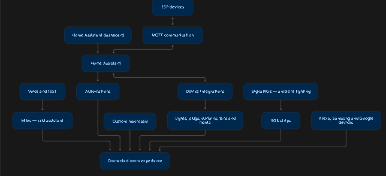
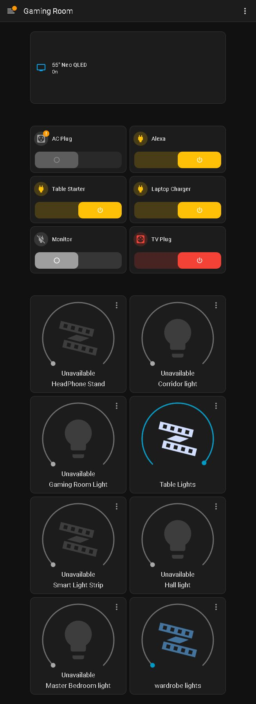
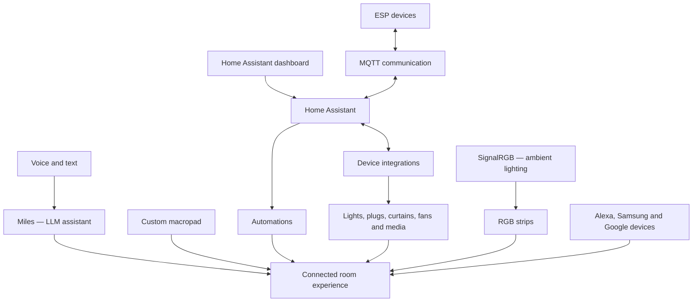
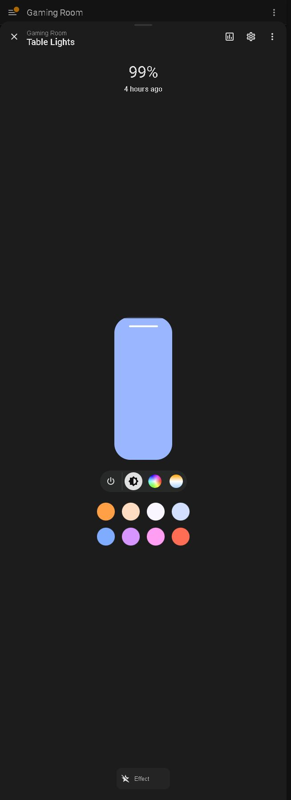
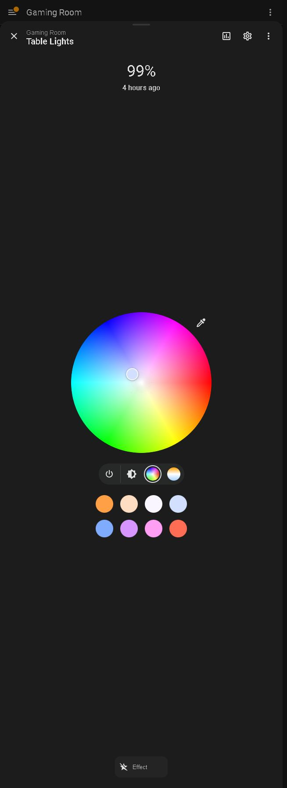
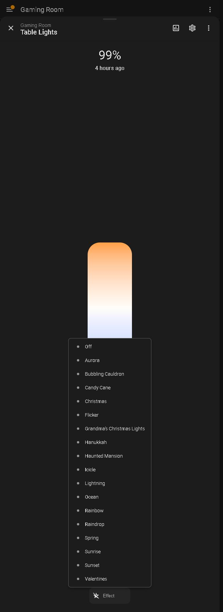
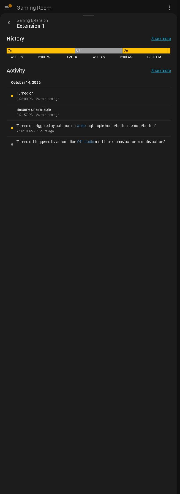
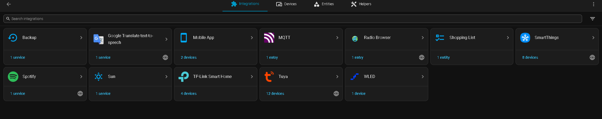
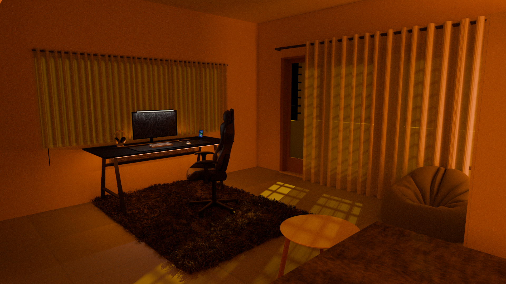
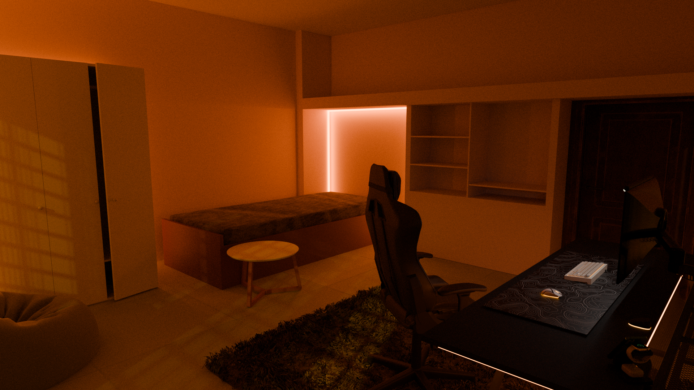

# Miles — My Connected Room

**An AI-enabled room built around Home Assistant, ESP devices, MQTT, a custom macropad, and connected lighting, curtains, fans, and media devices.**

Miles is my LLM-powered assistant for interacting with the room through **voice and text**. Alongside Miles, I use a Home Assistant dashboard, a physical macropad, automations, and Alexa, Samsung, and Google devices to control the space. The experience is inspired by JARVIS and FRIDAY: a room where everyday controls work together.

## What the room can do

| System | Role in the room |
| --- | --- |
| **Miles** | LLM-powered AI interaction through voice and text. |
| **Home Assistant** | Dashboard, device integrations, state history, and automations. |
| **ESP + MQTT** | Communication for ESP devices and automation triggers. |
| **Custom macropad** | Physical controls for connected devices. |
| **Lighting** | Connected room lights and RGB strips, with brightness, color, and supported effects. |
| **SignalRGB** | Control of RGB strips according to ambient lighting. |
| **Curtains and fans** | Connected as part of the complete room setup. |
| **Smart plugs** | Control of desk equipment, Alexa power, the TV plug, and the AC plug. |
| **Connected ecosystems** | Alexa, Samsung, and Google devices. |

## How the pieces fit together

The diagram below summarizes the roles of the main components. It is a conceptual overview; exact connection paths depend on the device and integration.

## Miles: voice and text

Miles adds an AI interface to the room through an LLM. Voice and text provide another way to interact with the setup alongside the dashboard and physical controls.

The assistant is called **Miles**. The specific LLM provider, model, speech recognition pipeline, and connection implementation are not included in this repository yet.

## The Gaming Room dashboard

The dashboard brings together **15 device cards**: one TV, six power controls, and eight lighting controls.

### TV and desk power

The **55-inch Neo QLED** card opens media controls for playback, mute, volume, and power, along with history and activity views.

The desk power controls use friendly dashboard names for the four sockets of **Gaming Extension**:

| Dashboard name | Device detail name |
| --- | --- |
| Alexa | Extension 1 |
| Table Starter | Extension 2 |
| Laptop Charger | Extension 3 |
| Monitor | Extension 4 |

**AC Plug** and **TV Plug** have separate power cards.

### Lighting

The lighting section includes:

- HeadPhone Stand
- Corridor light
- Gaming Room Light
- Table Lights
- Smart Light Strip
- Hall light
- Master Bedroom light
- wardrobe lights

Cards provide brightness controls, with additional controls in each light's detail panel where supported. **Table Lights** exposes brightness, a color wheel, color temperature, eight favorite colors, and an effects menu. **wardrobe lights** exposes brightness, color, favorite colors, and a white-light control.

View brightness, color, and effects controls

| Brightness and favorite colors | Color picker |
| --- | --- |
|  |  |

Table Lights offers effects including Aurora, Flicker, Lightning, Ocean, Rainbow, Sunrise, Sunset, and seasonal presets. SignalRGB also controls RGB strips according to ambient lighting as part of the broader room setup.

The screenshots capture a moment in time on **14 October 2026**. At capture, the AC plug and six lighting entities reported **Unavailable**; Table Lights was on at 99% brightness, and wardrobe lights was off. Unavailable entities remain visible in the dashboard, with their light controls disabled.

## MQTT and automations

MQTT connects ESP communication with the room's automations. The device activity view also makes it possible to trace changes back to their triggers.

During dashboard exploration, the activity for **Extension 1** showed these existing automation events:

| Automation | MQTT trigger topic shown in activity | Observed action |
| --- | --- | --- |
| `wake` | `home/button_remote/button1` | Turned Extension 1 on. |
| `Off studio` | `home/button_remote/button2` | Turned Extension 1 off. |

These are observed activity examples, rather than a complete description of every action in those automations. The custom macropad provides physical device control; its firmware and key mappings are not included here yet.

View MQTT-triggered automation activity

## Connected integrations

The supplied integrations overview shows:

| Integration | Shown in the overview |
| --- | --- |
| MQTT | 1 entry |
| SmartThings | 8 devices |
| TP-Link Smart Home | 4 devices |
| Tuya | 12 devices |
| WLED | 1 device |
| Mobile App | 2 devices |
| Google Translate text-to-speech | 1 service |
| Spotify | 1 service |
| Sun | 1 service |
| Backup | 1 service |
| Radio Browser | 1 entry |
| Shopping List | 1 entity |

These counts reflect the supplied screenshot. The Google Translate text-to-speech integration is present; the screenshot alone does not establish whether Miles uses it. SignalRGB, Miles, Alexa connectivity, and Google device connectivity are described from the room owner's setup and are not all represented as separate tiles in this overview.

## Room gallery

The supplied room visuals show the desk, curtains, seating, and lighting from two angles.

## About this repository

This repository documents an existing connected room and includes its dashboard screenshots and room visuals. It currently contains an overview of the system; ESP firmware, macropad firmware, Home Assistant configuration, automation YAML, wiring diagrams, and Miles implementation code are not included.

The dashboard observations, owner-provided setup details, and supplied images form the basis of this documentation.
